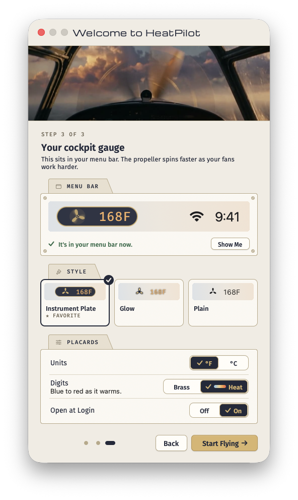
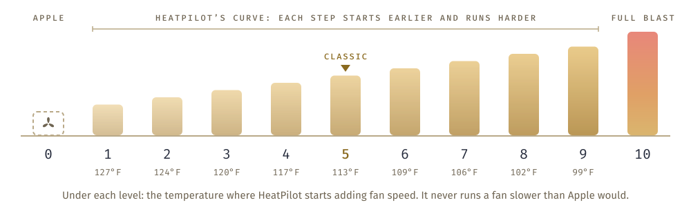
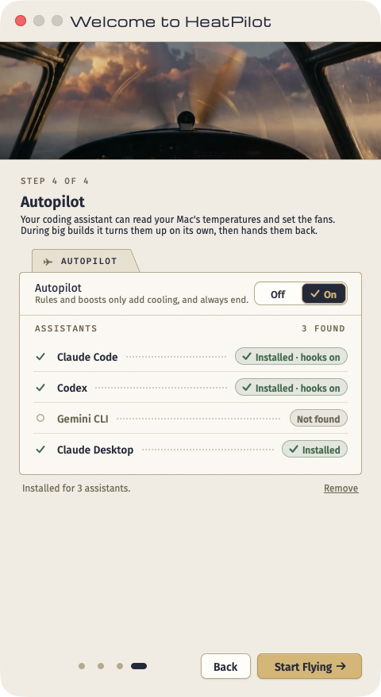
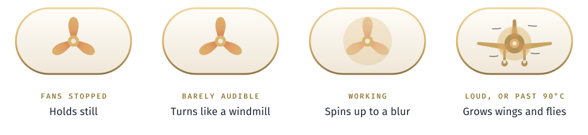
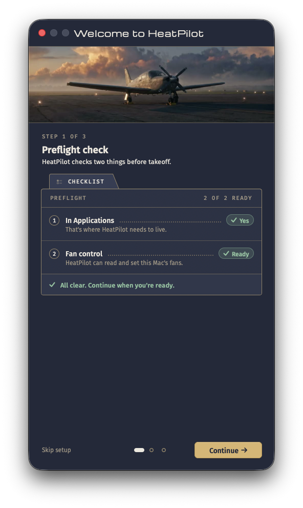
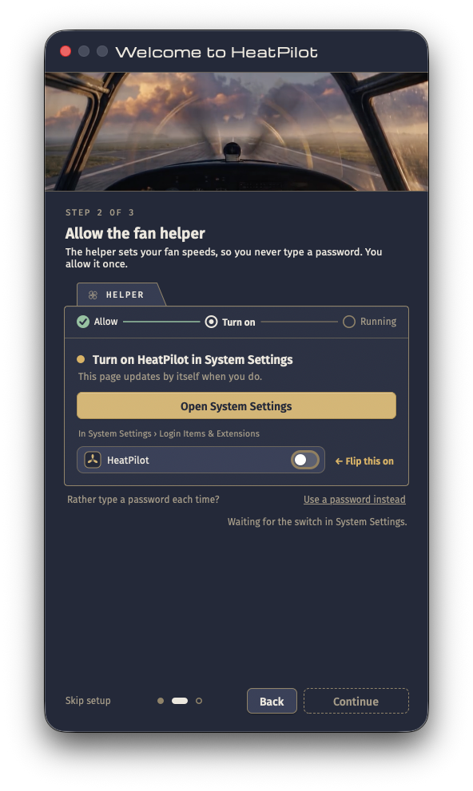
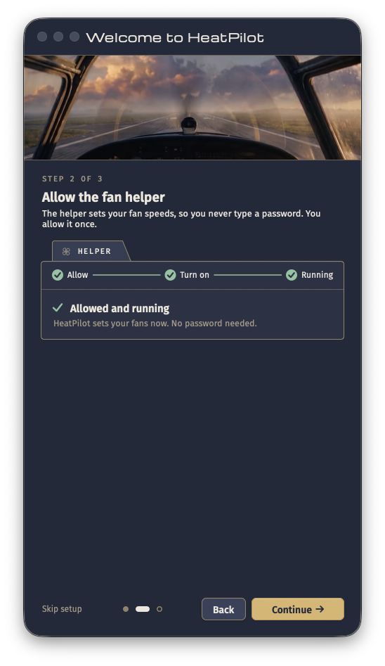
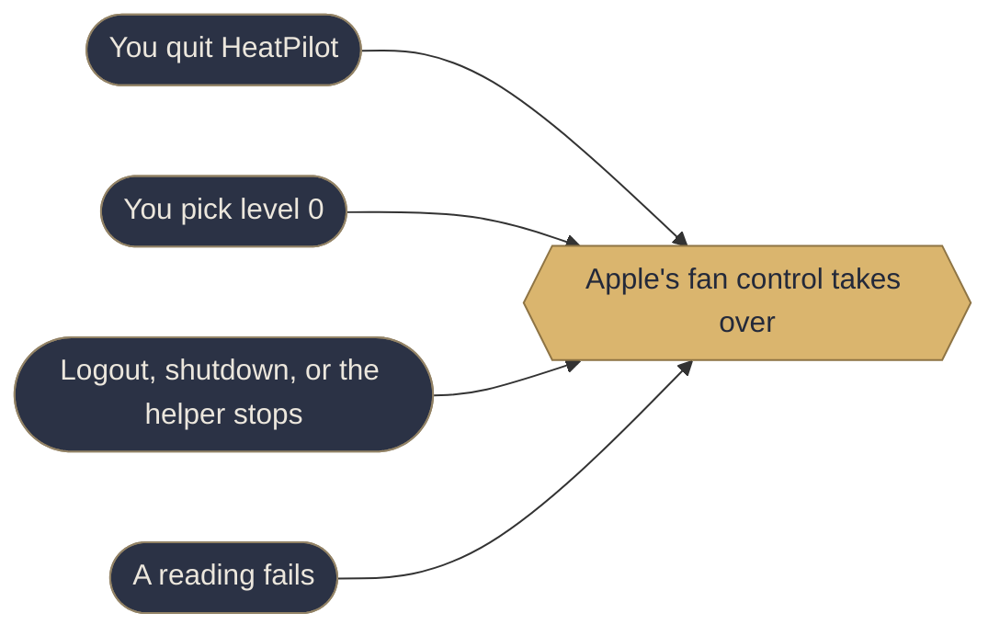
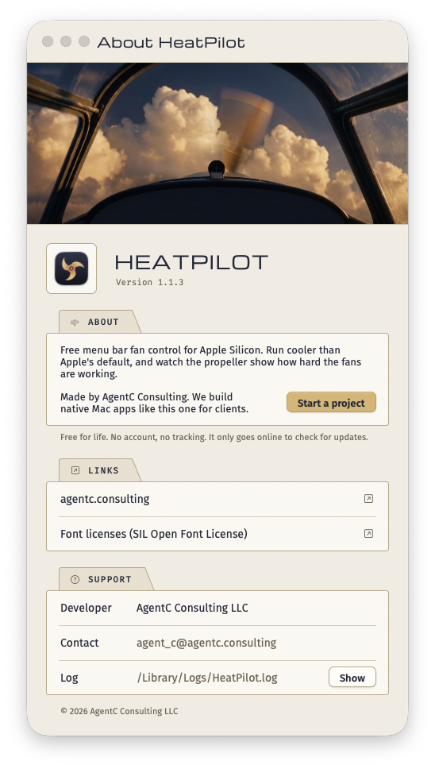

<a href="https://github.com/AgentC-Consulting/heatpilot/releases/latest/download/HeatPilot-Installer.dmg">
  
</a>

<p align="center">
  <a href="https://github.com/AgentC-Consulting/heatpilot/releases/latest/download/HeatPilot-Installer.dmg"></a>
</p>

<p align="center">
  <picture>
    <source media="(prefers-color-scheme: dark)" srcset="docs/brand/badges-dark.svg">
    
  </picture>
</p>

<p align="center">
  <b>HeatPilot turns your Mac's fans up before it gets hot.</b><br>
  One slider in your menu bar. Free for life.
</p>

<br>

## Your cockpit gauge

<p align="center">
  <picture>
    <source media="(prefers-color-scheme: dark)" srcset="docs/img/screens/gauge-dark.png">
    
  </picture>
</p>

<p align="center"><sub>Instrument Plate, Glow, or Plain. Digits in brass, or running blue to red as your Mac warms.</sub></p>

## One slider

<picture>
  <source media="(prefers-color-scheme: dark)" srcset="docs/brand/levels-dark.svg">
  
</picture>

0 is Apple's normal. 10 is every fan flat out. HeatPilot remembers your pick, even after a restart.

## Autopilot: your coding assistant flies the fans

<p align="center">
  <picture>
    <source media="(prefers-color-scheme: dark)" srcset="docs/img/screens/autopilot-dark.png">
    
  </picture>
</p>

Turn on Autopilot and Claude Code, Claude Desktop, Codex, or Gemini CLI can read your temperatures and turn the fans up for a big build, then hand them back.

- It only ever adds cooling on top of your level, and every boost ends on its own within 30 minutes.
- **Remove** puts each assistant's settings back as they were.

## The propeller tells you how hard your fans are working

<picture>
  <source media="(prefers-color-scheme: dark)" srcset="docs/brand/moods-dark.svg">
  
</picture>

## Up and flying in three steps

<table>
  <tr>
    <td align="center" valign="top" width="33%">
      
      <p><b>1 · Preflight</b><br><sub>Drag it to Applications. HeatPilot checks it can reach your fans.</sub></p>
    </td>
    <td align="center" valign="top" width="33%">
      
      <p><b>2 · Allow once</b><br><sub>Flip one switch in System Settings. No password after that.</sub></p>
    </td>
    <td align="center" valign="top" width="33%">
      
      <p><b>3 · Cleared for takeoff</b><br><sub>Pick a look and a level from the menu bar. Done.</sub></p>
    </td>
  </tr>
</table>

## Built to hand control back

Every way HeatPilot can stop leads back to Apple's own fan control.



- It never runs a fan slower than Apple would.
- Your level comes back after a restart. Fan speeds themselves never outlive one.
- No account, no tracking, no ads. It goes online only to check for its own updates.

> [!TIP]
> Trying Full Blast for the first time? Watch your temperatures for a few minutes before leaving it on.

## What's new

- **1.2.1** · A managed Mac's administrator can start the fan helper at install, so cooling works from the first boot. [Notes](docs/RELEASE_NOTES_v1.2.1.md)
- **1.2.0** · Autopilot, and cooling at the login window on managed Macs. [Notes](docs/RELEASE_NOTES_v1.2.0.md)
- **1.1.3** · Faster spin-up, Preferences after setup, and a drag-to-land installer. [Notes](docs/RELEASE_NOTES_v1.1.3.md)

## Questions

<details>
<summary><b>Will it work on my Mac?</b></summary>
<br>

Any Apple Silicon Mac with fans (MacBook Pro, Mac mini, Mac Studio, iMac, Mac Pro), on macOS 14 or newer. A MacBook Air has no fans, so there's nothing to turn up. HeatPilot still shows its temperatures.

</details>

<details>
<summary><b>Is it really free?</b></summary>
<br>

Yes, for life. [AgentC Consulting](https://agentc.consulting) builds Mac apps for businesses. This one's on us.

<p align="center">
  <picture>
    <source media="(prefers-color-scheme: dark)" srcset="docs/img/screens/about-dark.png">
    
  </picture>
</p>

</details>

<details>
<summary><b>How do I remove it?</b></summary>
<br>

Open the menu, hold <kbd>Option</kbd>, and choose **Remove Background Helper**. Then quit HeatPilot and drag it to the Trash.

</details>

<details>
<summary><b>Install with Homebrew</b></summary>
<br>

```bash
brew install --cask agentc-consulting/tap/heatpilot
```

</details>

<details>
<summary><b>Verify a download</b></summary>
<br>

Every release is signed with Apple Developer ID (`AgentC Consulting LLC (PXDF92M2T4)`), notarized by Apple, and ships a GPG-signed checksum file.

```bash
shasum -a 256 -c SHA256SUMS
gpg --verify SHA256SUMS.asc SHA256SUMS
spctl -a -t open --context context:primary-signature -vv HeatPilot-Installer.dmg
```

HeatPilot checks for updates once a day and installs only updates that carry our signature.
Release notes: [1.2.1](docs/RELEASE_NOTES_v1.2.1.md) · [1.2.0](docs/RELEASE_NOTES_v1.2.0.md) · [1.1.3](docs/RELEASE_NOTES_v1.1.3.md) · [1.1.2](docs/RELEASE_NOTES_v1.1.2.md) · [1.1.1](docs/RELEASE_NOTES_v1.1.1.md) · [1.1.0](docs/RELEASE_NOTES_v1.1.0.md) · [1.0.0](docs/RELEASE_NOTES_v1.0.0.md)

</details>

## Something off?

[Report fan behavior or a bug](../../issues/new/choose). Your Mac model and the level you were on help most. No GitHub account? [Tell us here](https://agentc.consulting/heatpilot).

<br>

<p align="center"><a href="https://agentc.consulting"><picture>
  <source media="(prefers-color-scheme: dark)" srcset="https://raw.githubusercontent.com/AgentC-Consulting/.github/main/brand/wordmark-dark.png">
  
</picture></a></p>
